# 架构与开发规范

本文件定义 `facet` 仓库的架构边界、核心不变量与开发步骤。在此仓库里生成代码、重构或修复缺陷时，按本文件执行。

## 1. 核心架构原则

1. **协议先行，读写分离**：写操作走 `dispatch` 帧异步派发，由 `(clientId, clientSeq)` 保证幂等；读操作走 `request` 帧查询快照或增量条目；服务端按通道定序推送 `ActionFrame`，端点订阅接收。
2. **纯核心，命令式外壳**：核心状态机（Agent 回合状态、客户端会话与对话归约）必须是无副作用的纯函数；网络 I/O、进程拉起、重连定时器与文件系统操作隔离在边缘外壳层。
3. **克制抽象**：只抽取无状态的数据算法与纯类型约定。生命周期、回收策略或流控机制不同的容器，不为了消除表面的代码重复合并成带回调钩子的通用类，边界按各自的生命周期定。

## 2. Monorepo 拓扑与依赖流向

依赖流向 MUST 严格单向，禁止反向引用与循环依赖。箭头 `-->` 是编译期或运行时依赖，点线 `-.->` 表示仅类型导入、进程拉起或内联扩展加载：

```mermaid
flowchart BT
  protocol["@facet/protocol<br/>(零运行时依赖 · 线格式 · AOT 类型守卫)"]

  transport["@facet/transport<br/>(字节切帧 / 请求应答配对)"]
  clientCore["@facet/client-core<br/>(重连调度 / 精确核销 / 纯归约投影)"]
  agent["@facet/agent<br/>(pi SDK 唯一防腐层 · 扩展注入)"]
  plugins["plugins/extensions/*<br/>(只依赖 pi SDK / pi-tui / typebox，不引用 @facet/*)"]

  ui["@facet/ui & ui-terminal / ui-editor<br/>(无状态视图与交互组件)"]

  server["apps/server<br/>(按域分开的 RPC 网关 / 通道定序)"]
  desktop["apps/desktop<br/>(main + renderer 单向 Hooks 组装壳)"]
  mock["tools/mock-server<br/>(协议一致性仲裁 · 混沌故障注入)"]

  transport --> protocol
  clientCore --> protocol
  agent --> protocol
  agent -. "BUILTIN_EXTENSIONS 注入" .-> plugins

  ui --> protocol
  ui -. "import type" .-> clientCore

  server --> protocol
  server --> transport
  server --> agent

  desktop --> protocol
  desktop --> transport
  desktop --> clientCore
  desktop --> ui
  desktop -. "spawn / import type" .-> server

  mock --> protocol
  mock --> transport
```



图中 `server` 与 `mock` 指向 `@facet/transport` 的两条边是允许的方向：两者当下的切帧与编解码直接取 `@facet/protocol` 的 `FrameDecoder` 与 `encodeFrame`，没有 import `@facet/transport`；要用到共享传输时按这两条边走。`desktop` 对 `server` 目前只有 `spawn`（拉起 `dist-server` 里的独立进程），没有类型导入。

### 依赖禁令（破例即阻断合并）

| 模块 | 允许依赖 | 严禁依赖与禁止行为 |
| :--- | :--- | :--- |
| `packages/protocol` | 无任何运行时第三方包 | 禁止在 `dependencies` 里放运行时校验库；`typebox` 只允许出现在 `devDependencies`。 |
| `packages/transport` | `@facet/protocol` | 禁止放入重连退避算法，禁止解析业务动作语义。 |
| `packages/agent` | `@facet/protocol`、`@earendil-works/pi-coding-agent` | 外部 SDK 只在此层归一化成纯 JSON 可序列化的 IR（`Message` / `SessionEvent` / `Action`）。 |
| `packages/client-core` | `@facet/protocol` | 禁止依赖 React、`electron` 与 `node:*`。 |
| `packages/ui` | `@facet/protocol`；`@facet/client-core` 仅 `import type` | 禁止导入 `@facet/transport`，禁止直接发起网络请求。 |
| `apps/server` | `@facet/protocol`、`@facet/transport`、`@facet/agent` | 禁止直接 `import` `@earendil-works/pi-coding-agent`；SDK 交互与持久化文件元数据操作一律经由 `@facet/agent`。 |
| `apps/desktop` | Workspace 内部包 | 渲染层禁止编写重连退避定时器；主进程对 `apps/server` 只允许类型导入与 `spawn` 拉起。 |

## 3. 各层核心不变量

### 3.1 协议与边界校验（`packages/protocol` 与 `apps/server/src/rpc`）

- **AOT 运行时守卫**：RPC 请求与客户端动作的类型约定写在 `packages/protocol/src/schema/contracts.ts`，由 `packages/protocol/scripts/gen-checks.mjs` 生成零依赖守卫到 `packages/protocol/src/generated/checks.ts`（提交入库）。
- **入站不信任**：传输层与网关入口收到的原始 JSON 必须先过 `SERVER_FRAME_CONTRACTS`、`REQUEST_CONTRACTS` 或 `DISPATCH_CONTRACTS`，才允许进入业务处理器。处理器里不写零散的字段断言，不出现未经校验的 `as Action`。
- **幂等去重**：`apps/server/src/rpc/gateway.ts` 维护有界的 `(clientId, clientSeq)` 去重窗口。重复投递的已成功 `dispatch` 绝不二次执行副作用；重复投递的已拒绝 `dispatch` 原样返回同一条 `rejectionReason`。

### 3.2 Agent 防腐层与状态机（`packages/agent`）

- **单一状态转移函数**：`TurnPhase` 只由 `packages/agent/src/events.ts` 的纯函数 `reduceTurnState(current, input)` 驱动。命令侧意图（请求启动、preflight 失败、请求中止、finally 收尾）与底层 SDK 事件都作为标准 `TurnInput` 喂入，`pi-agent.ts` 的异步方法里不直接给状态字段赋值。
- **出队取消令牌**：`session-hub` 的会话串行队列（`withSession`）在任务出队、准备执行 `agent.prompt()` 之前，必须校验轮次取消令牌，避免「取消已经完成，排队任务随后拉起一次没人停的运行」。

### 3.3 通道定序与增量订阅（`apps/server`）

- **统一缓冲与原子订阅顺序**：所有定序通道复用泛型 `EventLog<T>` 与无状态辅助函数 `replayAndSubscribe`。带 `sinceSeq` 重连续订时严格保持「`replay` 取历史快照 → `sinks.add` 注册订阅者 → 同步发送补发帧」的顺序，避免同步重入触发新发布时漏帧。
- **生命周期分开**：主机级单例通道（`sessions-channel`）在端点断开时只清订阅者、保留 `lastSeq`；会话通道（`session-hub`）按引用计数（`holders`）空闲回收；终端通道（`terminals`）独立维护水印背压（`ack`），并在 PTY 销毁时释放。三者不合并成带钩子的通用容器。

### 3.4 客户端投影与重连（`packages/client-core` 与 `apps/desktop`）

- **重连闭环**：指数退避重连调度与连接就绪后的 `resume()` 续订都内聚在 `packages/client-core`，对 UI 只暴露只读的连接状态快照与 `reconnectNow()`。
- **精确核销**：`pendingSend` 存在各自的会话槽位里，按 `clientSeq` 索引，不绑定到隐式的 `this.active` 单槽；收到带 `origin.clientSeq` 的确认帧时只核销对应那一条。
- **引用透明与按需重绘**：`reduceSession` 与 `reduceChat` 在状态没有实际变化时原样返回入参引用；`SessionStore.apply()` 只在视图引用或乐观发送状态变化时调用 `markChanged()`。
- **前端 Hooks 单向**：`App.tsx` 只是布局组装壳，状态逻辑按 `useHostConnection`（底层）→ `useSessionLifecycle` / `useTerminalPanel` / `useComposer` / `useWorkspaceShell`（中上层）单向依赖，禁止跨 Hook 双向同步与 `useEffect` 乒乓依赖。

## 4. 高频场景开发步骤

1. **新增 RPC 方法或客户端动作**
   1. 在 `packages/protocol/src/wire.ts` 与 `packages/protocol/src/schema/contracts.ts` 加类型与 Schema，不添加没有生产点的占位枚举。
   2. 运行协议生成脚本更新 `packages/protocol/src/generated/checks.ts`，确认 `parity.test.ts` 通过。
   3. 在 `apps/server/src/rpc/handlers/{session,chat,terminal,system}-handlers.ts` 里按域实现处理器。
2. **接入外部 SDK 新能力或持久化文件操作**
   1. 在 `packages/agent` 内完成 SDK 调用与类型转换，对外只暴露纯 JSON IR 类型与纯数据操作函数。
   2. 影响回合生命周期时，先在 `reduceTurnState` 的输入联合类型与转移表里补分支，并写纯函数单测。
3. **新增跨端异步确认或容错机制**
   1. 在 `tools/mock-server/index.ts`（TypeScript，纳入全仓类型检查）的故障注入控制口补对应故障场景，再写基于真实 `SessionClient` 的端到端集成测试。

## 5. 提交前必跑的质量门禁

在仓库根目录依次运行，五条都必须是退出码 `0`：

```bash
npm run mock:check   # 协议一致性冒烟检查
npm run typecheck    # 全仓 workspace 与 tools/mock-server 的静态类型检查
npm run lint         # 代码规范检查（含 React Hooks 依赖规则）
npm run test         # 全仓单元测试、类型等价测试与混沌集成测试
npm run build        # 全仓生产构建
```

任何一条失败都算阻断项：先修好再提交，不带着红灯往 `dev` 或 `main` 推进。

# 开发与提交规范

- 分支模型：`main` 为可运行主线；`dev` 承载最终态的文档与基础架构，定稿后合入 `main`，此后开发从 `main` 切出；`feature-<name>` 与 `fix-<name>` 均从 `main` 切出并合回 `main`。
- 交付到 `main` 的是最终态的文档与可运行的基础架构，中间态与草稿不进入 `main`。
- `dev` 上允许中途提交；合入 `main` 之前，第 5 节那五条门禁必须全绿。
- 新功能 MUST 在 `feature-<name>` 分支开发，完成后合入 `main`；合入用 squash，使 `main` 上一个功能对应一条提交。
- 缺陷修复用 `fix-<name>`，文档与规范改动提交到 `dev`。
- 一个分支 SHOULD 只动一个模块（`packages/` 下的一个包或 `apps/` 下的一个应用）的代码，遵循最小改动原则。
- 跨模块改动只允许依赖声明、导入路径、类型定义、构建与配置文件这类使改动生效所必需的部分，且 MUST 在提交说明正文点名涉及的其他模块。
- 依赖方向单向，禁止反向引用：`protocol ← agent / client-core / transport ← ui ← apps`。
- `protocol` MUST 保持零运行时依赖。`client-core` 与 `ui` MUST NOT 引入 `electron`、`node:*`。`services` MUST NOT 引入 `electron` 与 React。
- `plugins/` 下的 pi 扩展与 skill 只依赖 pi SDK、pi-tui 与 typebox，不引用 `@facet/*`；适配 facet 专有能力时做运行时能力检测，缺失时返回明确错误。
- 需要随 facet 分发的扩展加进 `packages/agent/src/runtime.ts` 的 `BUILTIN_EXTENSIONS`，作为内联扩展注入；不得把它写进 pi 的 agent 目录。需要压过用户同名扩展的内置插件，同时加进 `PRIORITY_BUILTIN_PATHS`。
- `apps/server` MUST NOT 依赖 `electron`：主机与它起的子进程一律按 Node 运行，桌面只负责用 `process.execPath` 加 `ELECTRON_RUN_AS_NODE=1` 把它拉起来，并把环境原样传给它的子进程。
- 提交说明用中文，格式 `<type>(<scope>): <结果>`，`type` 取 `feat` / `fix` / `docs` / `chore` / `refactor` / `perf` / `test`，`scope` 为包名或应用名。
- 提交说明只描述改动完成后的状态与原因，不记录被放弃的做法。
- 不提交 `node_modules/`、`out/`、`dist/`、编辑器临时文件与本地数据目录。
- 需求与设计变更同步更新 `docs/` 下对应文档，并与代码在同一分支提交。

# 注释规范

- 本节优先于任何「不写注释」的通用约定；与其他规范冲突时以本节为准。
- 数据结构与字段定义 MUST 有注释：类型、接口、枚举与对象的每个成员，写明含义与取值约束。
- 关键逻辑 MUST 有注释：非显然的判定顺序、失败降级、时序约束、绕过外部限制的处理，都要写明原因。
- 适度：显而易见的代码不写注释，不复述代码本身。
- TypeScript 使用 JSDoc/TSDoc 风格；模块、导出的类型与函数写文档注释，内部实现按第一、二条处理。
- 技术术语保留英文原词，例如 API、JSON、Token、IPC、SSE；解释性文字用简洁中文。
- 注释只描述当前状态与原因，不记录改动历史。
- 加注释 MUST NOT 改动被注释的代码逻辑。

# 样式与尺寸规范

- 位置与间距 MUST 由 `:root` 里的 CSS 变量给出，规则里只引用变量；同一个数值不写在两个选择器里，也不靠多层 padding 叠加凑位置。
- 变量按「一处几何关系一个名字」命名，注释写清它量的是哪两点，例如 `--indent-rail-offset`（竖线到行内容）、`--indent-rail-label`（行内容到短名列）。
- 派生的值用 `calc()` 从变量算，例如 `calc(var(--indent-rail-offset) - 1px)`；一条几何关系里只留一个基准数。
- 新组件需要横向间距时，先看有没有能复用的变量，没有就在 `:root` 里补一个并写清参照物，再在规则里引用。

# 界面表达

- 状态 MUST 由样式本身表达：用颜色、图标、动效区分进行中、完成、失败、未执行，界面里不出现「失败」「未执行」「执行中」这类状态文字。
- 界面文字只描述对象自身——名字、路径、内容、数量；系统状态、行为说明、操作约束都不写成文字。
- 需要解释的地方由控件承担：按钮可用与否、是否灰掉、光标形态，代替写一句话说明为什么不能点。
- 提示信息同样遵守这条：错误、告警只给事实内容，不叠加「出错」之类的标签。
