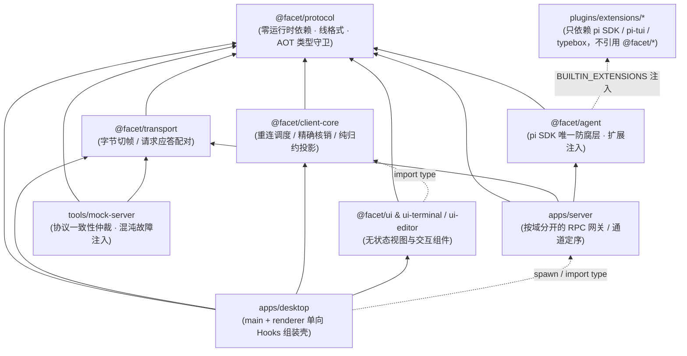

# 架构

本文件描述 `facet` 的分层、拓扑与各层不变量。**规则与红线**（依赖禁令、提交与注释规范）在仓库根的 `AGENTS.md`；这里讲的是它们背后的结构，以及改动落到哪一层。

## 1. 核心架构原则

1. **协议先行，读写分离**：写操作走 `dispatch` 帧异步派发，由 `(clientId, clientSeq)` 保证幂等；读操作走 `request` 帧查询快照或增量条目；服务端按通道定序推送 `ActionFrame`，端点订阅接收。
2. **纯核心，命令式外壳**：核心状态机（Agent 回合状态、客户端会话与对话归约）必须是无副作用的纯函数；网络 I/O、进程拉起、重连定时器与文件系统操作隔离在边缘外壳层。
3. **克制抽象**：只抽取无状态的数据算法与纯类型约定。生命周期、回收策略或流控机制不同的容器，不为了消除表面的代码重复合并成带回调钩子的通用类，边界按各自的生命周期定。

## 2. Monorepo 拓扑与依赖流向

依赖流向 MUST 严格单向，禁止反向引用与循环依赖。箭头 `-->` 是编译期或运行时依赖，点线 `-.->` 表示仅类型导入、进程拉起或内联扩展加载：

图中 `server` 与 `mock` 指向 `@facet/transport` 的两条边是允许的方向：两者当下的切帧与编解码直接取 `@facet/protocol` 的 `FrameDecoder` 与 `encodeFrame`，没有 import `@facet/transport`；要用到共享传输时按这两条边走。`desktop` 对 `server` 目前只有 `spawn`（拉起 `dist-server` 里的独立进程），没有类型导入。

## 3. 依赖禁令（破例即阻断合并）

| 模块 | 允许依赖 | 严禁依赖与禁止行为 |
| :--- | :--- | :--- |
| `packages/protocol` | 无任何运行时第三方包 | 禁止在 `dependencies` 里放运行时校验库；`typebox` 只允许出现在 `devDependencies`。 |
| `packages/transport` | `@facet/protocol` | 禁止放入重连退避算法，禁止解析业务动作语义。 |
| `packages/agent` | `@facet/protocol`、`@earendil-works/pi-coding-agent` | 外部 SDK 只在此层归一化成纯 JSON 可序列化的 IR（`Message` / `SessionEvent` / `Action`）。 |
| `packages/client-core` | `@facet/protocol` | 禁止依赖 React、`electron` 与 `node:*`。 |
| `packages/ui` | `@facet/protocol`；`@facet/client-core` 仅 `import type` | 禁止导入 `@facet/transport`，禁止直接发起网络请求。 |
| `apps/server` | `@facet/protocol`、`@facet/transport`、`@facet/agent` | 禁止直接 `import` `@earendil-works/pi-coding-agent`；SDK 交互与持久化文件元数据操作一律经由 `@facet/agent`。 |
| `apps/desktop` | Workspace 内部包 | 渲染层禁止编写重连退避定时器；主进程对 `apps/server` 只允许类型导入与 `spawn` 拉起。 |

## 4. 各层核心不变量

### 4.1 协议与边界校验（`packages/protocol` 与 `apps/server/src/rpc`）

- **AOT 运行时守卫**：RPC 请求与客户端动作的类型约定写在 `packages/protocol/src/schema/contracts.ts`，由 `packages/protocol/scripts/gen-checks.mjs` 生成零依赖守卫到 `packages/protocol/src/generated/checks.ts`（提交入库）。
- **入站不信任**：传输层与网关入口收到的原始 JSON 必须先过 `SERVER_FRAME_CONTRACTS`、`REQUEST_CONTRACTS` 或 `DISPATCH_CONTRACTS`，才允许进入业务处理器。处理器里不写零散的字段断言，不出现未经校验的 `as Action`。
- **落盘路径只认本机的**：`createSession` 的 `cwd`、项目清单的 `add` 都先按主机自己的磁盘核对（`resolveProjectDirectory` / `isProjectDirectory`），不存在或不是目录的一律拒绝；扫描历史会话遇到脏 `cwd` 静默跳过。端可能还握着另一台机器的路径（Windows 的 `C:\Program Files\facet` 在 Linux 上就是一条相对路径），在这里挡住之后它既进不了 `projects.json`，也不会在数据目录下凭空建出同名目录。
- **幂等去重**：`apps/server/src/rpc/gateway.ts` 维护有界的 `(clientId, clientSeq)` 去重窗口。重复投递的已成功 `dispatch` 绝不二次执行副作用；重复投递的已拒绝 `dispatch` 原样返回同一条 `rejectionReason`。

### 4.2 Agent 防腐层与状态机（`packages/agent`）

- **单一状态转移函数**：`TurnPhase` 只由 `packages/agent/src/events.ts` 的纯函数 `reduceTurnState(current, input)` 驱动。命令侧意图（请求启动、preflight 失败、请求中止、finally 收尾）与底层 SDK 事件都作为标准 `TurnInput` 喂入，`pi-agent.ts` 的异步方法里不直接给状态字段赋值。
- **出队取消令牌**：`session-hub` 的会话串行队列（`withSession`）在任务出队、准备执行 `agent.prompt()` 之前，必须校验轮次取消令牌，避免「取消已经完成，排队任务随后拉起一次没人停的运行」。

### 4.3 通道定序与增量订阅（`apps/server`）

- **统一缓冲与原子订阅顺序**：所有定序通道复用泛型 `EventLog<T>` 与无状态辅助函数 `replayAndSubscribe`。带 `sinceSeq` 重连续订时严格保持「`replay` 取历史快照 → `sinks.add` 注册订阅者 → 同步发送补发帧」的顺序，避免同步重入触发新发布时漏帧。
- **生命周期分开**：主机级单例通道（`sessions-channel`、`models-channel`）在端点断开时只清订阅者、
  保留 `lastSeq`；会话通道（`session-hub`）按引用计数（`holders`）空闲回收；终端通道（`terminals`）
  独立维护水印背压（`ack`），并在 PTY 销毁时释放。它们不合并成带钩子的通用容器。
- **终端按平台探测 shell**：Windows 上没有 `SHELL`，也不是「有 bash 就行」——pwsh、Windows
  PowerShell、Git Bash、WSL、`cmd.exe` 的路径与启动参数各不相同。`terminal-profiles.ts` 是
  纯函数（平台、环境变量、`exists` 都由调用方给），按 VS Code 的顺序探测：pwsh → Windows
  PowerShell → Git Bash → WSL → `cmd.exe`，缺省取第一个；POSIX 上仍是 `$SHELL`（没有则
  `/bin/sh`）。探测结果也是「有哪些终端」的来源，界面据此让用户挑。
- **按目录盯工作树**：`workspace:/<cwd>` 一个项目目录一条，订阅即由 `workspaces` 建一份
  `ProjectWatch`（逐目录 `fs.watch`，跳过被忽略的目录，500ms 合并），最后一个订阅者走了就停；
  动作只有 `workspace/changed`，`history` 标出 HEAD 或引用是否动过，状态仍由端按需来取。
- **git 只有一条出口**：所有子进程都走 `apps/server/src/git-exec.ts`，业务层不再自己
  `execFile("git", …)`。只读调用首位加 `--no-optional-locks` 并设 `GIT_OPTIONAL_LOCKS=0`
  （`status` 之类不会顺手刷新索引自己去撞 `index.lock`）；写入调用反过来不加这两项，改为按
  仓库根目录串行、撞上外部占用的 `index.lock` 时短退避重试。两条通道都关掉交互式凭据提示
  （子进程不会挂在等 TTY 上），都带 `-c core.quotepath=false`，用户的 `PATH`、`SSH_AUTH_SOCK`
  与 `GPG_TTY` 原样传下去；读取支持 `AbortSignal`（SIGTERM，宽限后 SIGKILL）、超时与输出上限，
  三者都翻成可识别的错误而不是原始报错。
- **按仓库排队查询**：按规范化后的仓库根目录隔离，同一时刻同一个仓库只跑一条。可变的工作区态
  （`status`、工作区单文件 `diff`、分页 `log`）走 **latest-wins**：新请求到来就把在途子进程
  `abort()` 掉，等在它上面的那一批一起改拿最新结果，既不会漏掉最新改动也不让进程堆起来；
  不可变的历史态（某个提交的详情、提交内某个文件的补丁）走 **single-flight**：在途时新请求
  直接搭车。状态车道跑完冷却 1500ms、提交历史车道 5000ms，两条互不阻塞，`force` 跳过冷却。
  `git status --porcelain=v2 --branch -z -uall` 流式消费，分支信息与文件条目一次读完；累计到
  5000 条立刻 kill，跳过 `diff --numstat` 与逐文件读行数，结果标 `truncated`，界面据此暂停
  自动刷新。

### 4.4 客户端投影与重连（`packages/client-core` 与 `apps/desktop`）

- **重连闭环**：指数退避重连调度与连接就绪后的 `resume()` 续订都内聚在 `packages/client-core`，对 UI 只暴露只读的连接状态快照与 `reconnectNow()`。
- **精确核销**：`pendingSend` 存在各自的会话槽位里，按 `clientSeq` 索引，不绑定到隐式的 `this.active` 单槽；收到带 `origin.clientSeq` 的确认帧时只核销对应那一条。
- **引用透明与按需重绘**：`reduceSession` 与 `reduceChat` 在状态没有实际变化时原样返回入参引用；`SessionStore.apply()` 只在视图引用或乐观发送状态变化时调用 `markChanged()`。
- **按主机隔离**：每台主机一套运行时（`host-runtime.ts`：传输、会话客户端、终端客户端与连接链路，按端点存在注册表里）。界面里同时只挂当前主机的一份工作区，切走即卸载、切回按工作区快照（标签、文件内容、选中会话、落地目录）重建；后台主机的连接不停，只有显式断开才退订、关连接并丢掉它的快照。
- **系统通知是主进程的事**：渲染层只把「哪个会话、什么状态词」发过来（`main/notify.ts`），
  「窗口在不在前台」的判断、通知对象与点击回传都留在主进程；点通知先把窗口拉回前台，再把会话
  文件发回界面走侧栏同一个入口切过去。状态到通知的换算在 `notification-events.ts` 里，只有
  收尾时刻变了或从没人等变成有人等才弹。
- **前端 Hooks 单向**：`App.tsx` 只挑当前主机的运行时并把工作区摆出来，其余状态逻辑在工作区内部按 `useHostConnection`（底层）→ `useSessionLifecycle` / `useTerminalPanel` / `useComposer` / `useWorkspaceShell`（中上层）单向依赖，禁止跨 Hook 双向同步与 `useEffect` 乒乓依赖。

## 5. 高频场景开发步骤

1. **新增 RPC 方法或客户端动作**
   1. 在 `packages/protocol/src/wire.ts` 与 `packages/protocol/src/schema/contracts.ts` 加类型与 Schema，不添加没有生产点的占位枚举。
   2. 运行协议生成脚本更新 `packages/protocol/src/generated/checks.ts`，确认 `parity.test.ts` 通过。
   3. 在 `apps/server/src/rpc/handlers/{session,chat,terminal,system}-handlers.ts` 里按域实现处理器。
2. **接入外部 SDK 新能力或持久化文件操作**
   1. 在 `packages/agent` 内完成 SDK 调用与类型转换，对外只暴露纯 JSON IR 类型与纯数据操作函数。
   2. 影响回合生命周期时，先在 `reduceTurnState` 的输入联合类型与转移表里补分支，并写纯函数单测。
3. **新增跨端异步确认或容错机制**
   1. 在 `tools/mock-server/index.ts`（TypeScript，纳入全仓类型检查）的故障注入控制口补对应故障场景，再写基于真实 `SessionClient` 的端到端集成测试。

## 相关文档

- `AGENTS.md`：依赖红线、提交与注释规范
- `docs/testing.md`：自检命令、改到什么跑哪几条、流水线
- `docs/protocol-rpc.md`：线格式、帧与 RPC 方法
- `docs/ui_design_specification.md`：界面设计与尺寸规范
- `docs/i18n.md`：界面语言与文案规则
